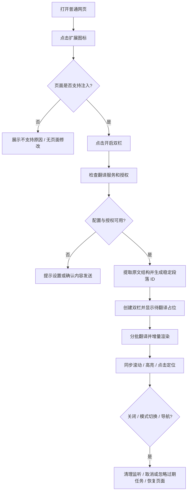

# AlignRead（对阅）— 产品需求文档（PRD）

> **产品英文名**：AlignRead  
> **产品中文名**：对阅  
> **产品定位**：智能双栏网页翻译与原译对照阅读  
> **文档版本**：v1.1  
> **需求基线日期**：2026-11-15  
> **实现同步日期**：2026-11-16  
> **状态**：0.1.3 已通过本地发布验收，商店材料已备齐。 [项目进度](progress.md)  
> **产品平台**：Google Chrome 桌面浏览器，Manifest V3 扩展  
> **参考产品**：[SplitTranslate](https://chromewebstore.google.com/detail/splittranslate-dual-pane/ikiphdehagbfmhenpdbeepgkebdgbkhi)（布局和对照阅读交互参考；不复制其代码、素材、品牌或未公开实现）

---

## 1. 项目背景与目标

### 1.1 背景

传统网页翻译主要提供两种阅读方式：替换原文，或者在每段原文后插入译文。前者不方便核对原文；后者容易让页面变长、阅读视线不断上下跳转。希望提供一种以**左右双栏对照阅读**为核心的 Chrome 扩展：左侧保留可交互的原始网页，右侧呈现结构化翻译内容，支持双向定位、高亮及同步滚动，同时覆盖常用的选词、段落和替换式整页翻译。

### 1.2 产品定位

**AlignRead（对阅）**是一款面向外语文章、技术文档、知识库等内容的 Chrome 网页翻译和双语阅读工具。**核心价值不是“能翻译”，而是“保持阅读上下文并快速核对原文”。**

### 1.3 目标

- 在支持的常规网页上，一次操作开启/关闭双栏翻译。
- 左侧仍是原始网页，正常点击链接、选择文本、浏览内容；右侧独立呈现译文阅读视图。
- 用户滚动或选择任一栏内容，能够可靠找到对应的另一栏内容。
- 翻译失败、页面变动、切换模式或关闭插件后，不遗留破坏页面的布局或文本修改。
- 将内容提取、译文呈现、翻译引擎与对齐映射解耦，为后续扩展翻译 Provider 和精细化词组映射留出接口。

### 1.4 非目标

- 第一版不追求还原任意网站的完整可交互“翻译镜像”。右侧为只读译文阅读视图，不运行原网站的脚本或表单。
- 第一版不承诺支持所有 Chrome 页面、跨域 iframe、浏览器原生 PDF 阅读器、Google Docs 编辑器、Canvas 渲染内容等。
- 第一版不提供 OCR、视频字幕翻译、语音翻译、账户同步、付费订阅、词组级精确双语对齐。
- 不绕过网站权限、登录、付费墙或浏览器限制。

### 1.5 产品命名与标识规范（已确认）

| 用途 | 统一标识 | 约定 |
|---|---|---|
| 正式英文名称 | **AlignRead** | 产品 UI、正式文档、Chrome 商店优先使用 |
| 中文名称 | **对阅** | 用于中文介绍、帮助文案和中文商店描述 |
| 产品完整描述 | **AlignRead — 双栏网页翻译** | 商店展示名称候选，提交前核查平台要求 |
| GitHub 项目仓库 | `alignread` | 默认建议；如需要独立扩展仓库，使用 `alignread-extension` |
| 扩展工程目录 | `alignread-extension/` | 与未来后端服务、文档仓库区分 |
| npm package 名 | `alignread-extension` | 发布前须检查 npm 命名可用性，不预设已注册 |
| 文档主路径 | `docs/AlignRead_PRD_v1.1.md` | 当前仓库需求文档 |
| 产品英文标语（候选） | *Read side by side. Understand in context.* | 非核心需求，视觉设计阶段可修改 |

**命名说明**：本轮已确定项目使用 AlignRead（对阅），但尚未完成商标、域名、Chrome 商店与 npm 命名可用性核验。提交公开商店或注册商业品牌前，须完成重名与权利冲突检查；若最终品牌需要调整，不影响本 PRD 的功能与技术要求。

## 2. 用户与典型场景

| 用户群 | 主要场景 | 最看重的能力 |
|---|---|---|
| 开发者 | 阅读英文技术文档、README、技术博客 | 代码不被翻译，译文与原文迅速定位 |
| 学习者 | 读外语文章、学习术语 | 双栏对照、选词翻译、句子高亮 |
| 通用阅读用户 | 新闻、博客、知识类页面 | 一键整页翻译、页面不被破坏 |

**典型用户故事**

- US-01：作为技术文档读者，我想左边阅读原文右边看中文，看到疑似误译时能直接点击译文文字定位对应的英文段落。
- US-02：作为阅读者，我想拖动分隔条调整两栏宽度，避免窄屏下英文内容过度折行。
- US-03：作为学习者，我想选中一个单词或句子，快速看简短翻译，而不切换标签页。
- US-04：作为普通用户，我想切换为“仅译文”，在当前网页直接浏览中文并能随时恢复原文。
- US-05：作为注重隐私的用户，我想明确知道页面内容是否发送到第三方，以及哪些页面被排除。

## 3. 范围、优先级与交付阶段

优先级定义：**P0** = MVP 必须；**P1** = 首个稳定版增强；**P2** = 后续迭代。P0 并不代表兼容所有网站。

| 功能编号 | 功能 | 优先级 | 说明 |
|---|---|---|---|
| F-01 | 插件入口与翻译模式切换 | P0 | Popup 入口；开启/关闭双栏；选择语言和服务 |
| F-02 | 网页内容结构化提取 | P0 | 支持整页可见文字和仅正文，保留常见阅读结构及横向分组 |
| F-03 | 页面内左右双栏阅读 | P0 | 原网页 + 右侧只读译文；可拖动分隔条 |
| F-04 | 段落级双向高亮与点击定位 | P0 | 直接点击文字定位对侧，译文段落支持 Enter |
| F-05 | 双向按段落同步滚动 | P0 | 可开关；防反馈循环 |
| F-06 | 翻译 Provider、调度、进度与重试 | P0 | 最低要求为一个可用服务。0.1.3 已接入 Google Cloud Translation Basic 和有道智云 |
| F-07 | 原网页恢复、失败回退 | P0 | 关闭或切换后不残留插件修改 |
| F-08 | 设置、语言、缓存与隐私告知 | P0 | 目标语言、缓存开关、页面授权 |
| F-09 | 选词弹窗翻译 | P1 | 选词后触发，不强制自动弹窗 |
| F-10 | 原文下方插入段落译文 | P1 | 段落双语模式 |
| F-11 | 替换式整页翻译 | P1 | 仅替换文本节点、可恢复 |
| F-12 | 句子级高亮/选中译文定位原文 | P1 | 映射可信时精确到句子；失败回退段落 |
| F-13 | SPA 动态内容增量翻译 | P1 | MutationObserver 与路由变化处理 |
| F-14 | 词组级精细双语映射 | P2 | 需要额外对齐能力，不与字数偏移等同 |
| F-15 | 浏览器内本地翻译与扩展 Provider 支持 | P2 | 视浏览器、语言对与授权能力而定 |
| F-16 | PDF、网页复杂表格/数学公式专项适配 | P2 | 独立研发里程碑 |
| F-17 | 站点规则、术语表、语言自动检测优化 | P2 | 个性化阅读体验 |

**MVP 发布门槛**：F-01 至 F-08 完成且通过第 12 章验收；默认整页范围仅指用户可见的可阅读文本，不包含跨域或浏览器禁止访问的内容；不以 F-09 至 F-17 为 MVP 发布阻塞条件。

## 4. 信息架构与入口

### 4.1 主要页面 / 组件

1. **扩展 Popup**：当前标签页状态、模式切换、语言方向、翻译范围（整页可见内容 / 仅正文）、当前翻译服务、开启/暂停/继续/关闭双栏、打开设置。
2. **页面内翻译工具栏**：显示双栏模式、进度、源和目标语言、同步滚动、悬停高亮、暂停和继续、失败重试及关闭入口。
3. **双栏布局**：左栏是现有页面的内容与交互，右栏是插件生成的结构化译文阅读面板；中间有拖动分隔条。
4. **设置页**：默认语言及范围、翻译服务及授权、阅读偏好、缓存和禁用站点。
5. **选词翻译弹窗**（P1）：所选文本、译文、复制、关闭及可选重新翻译操作。

### 4.2 用户主流程



## 5. 双栏核心体验与交互规范（P0）

### 5.1 布局

- 原网页始终在**左侧**，译文在**右侧**；不通过 iframe 复制网站，也不复制网站脚本及表单逻辑。
- 默认两栏各占可用视口的一半。拖动分隔条或聚焦后按左右方向键，可将原文栏调整至 **35% 到 70%**。
- 记录本机上一次成功调整的栏宽；新的标签页默认继承个人布局偏好，但不继承另一标签页的翻译任务。
- 右栏独立滚动，且有清晰的边界和工具栏。原网页保留正常链接、文本选择、可见交互行为。
- **不要宣称“原网页像素级不变”**：视口缩窄会触发原站响应式 CSS；以“内容和主要交互可用、不发生无法恢复的破坏”为验收目标。
- 视口不足 **960 CSS px** 时提示扩大窗口。已开启双栏时缩到阈值以下，会恢复为原网页。

### 5.2 分栏及页面原貌保护

- 采用宿主元素 + **Shadow DOM** 挂载右侧组件，隔离插件样式；必要时对原页面施加受控宽度约束，并记录每项修改的旧值。
- 在翻译器关闭时精确清理新增 DOM、事件监听、观察器、样式覆盖、定时任务与高亮；恢复被修改的 inline style，仅恢复插件真正更改过的属性。
- 对无法安全缩窄的站点，恢复原网页并提示布局检查失败。
- 全屏元素、悬浮弹窗、固定导航、z-index、sticky、滚动锁定需加入适配测试。

### 5.3 右侧译文的内容表达

- 默认翻译范围为**当前网页的可见、可阅读文本**（标题、正文、导航、侧栏、页脚等可识别区域），右栏按页面区域分组并保留阅读顺序；用户也可切换为“仅正文”，过滤导航和重复控件，以便专注阅读。隐藏节点、脚本、表单数据和非文本绘制不属于“整页可翻译内容”。
- 右侧按原文阅读顺序保留标题、段落、列表、引用、链接、代码块、图注、定义列表和表格结构，以及显式换行、强调、上下标等行内格式。
- 右栏有空间时保留可识别的横排卡片和页脚列组，窄栏可换行。横排 Tab 保留顺序和可识别的选中态，空间不足时可在 Tab 条内横向滚动。普通列表保留适用的项目符号或编号。
- 提示框保留可识别的背景、边框和圆角。折叠区按启动时的可见状态呈现。宽表格保留表头、合并单元格及对齐，并可独立横向滚动。
- **代码块、命令、URL、版本号和标识符默认不翻译**；代码周围的解释性文字可翻译。
- 图片在译文栏使用保留尺寸或比例的占位，图注作为可翻译文本处理。
- 右侧链接点击按用户可见的链接行为处理，跳转前遵守浏览器默认安全行为；不要执行页面或翻译结果中返回的脚本。
- 使用 DOM API / 安全文本渲染承载译文，不把模型返回内容当作可信 HTML 注入。
- 文本量较大时可先渲染可见段落并显示骨架状态，翻译逐块更新。

### 5.4 段落映射规则

- 原文每个可翻译块分配 `segmentId`，记录源页面定位信息、阅读顺序、文本指纹以及源 DOM Range/节点关联信息。
- 译文项必须保留相同 `segmentId`，形成一对一的**段落级 UI 映射**；翻译请求可以批量发送，但返回必须能归属到原段落。
- 相同文字在不同位置必须获得不同 ID；不能仅以文本字符串作为段落 ID。
- 源节点消失或结构变更后，旧映射标记失效，禁止高亮到无关内容；可尝试重新定位与重建映射。
- 段落拆分和合并必须由预处理规则显式确定，不应默认“一个 HTML 元素就是一个段落”。

### 5.5 高亮、点击与选择

- **P0 段落级**：鼠标悬停任一栏的段落，双栏对应段落显示轻量背景高亮；离开时清除临时高亮。
- 直接点击译文文字，左栏滚到对应原文段落并高亮。点击原文普通文字可反向定位。每段译文末尾无需附加「原文」入口。
- 高亮不得遮挡鼠标点击、禁止改变段落真实文本内容或破坏原文事件处理。
- 真实链接保留导航行为，右侧安全链接在新标签页打开。译文段落可用 Tab 聚焦后按 Enter 定位，拖选文字时保留浏览器的文本选择行为。
- 原文高亮优先通过 CSS Custom Highlight / `Range` 等非破坏性机制实现；兼容方案须避免拆散原文本节点、覆盖原站 DOM 事件。
- **P1 句子级**：在可靠切句和翻译对齐情况下，选中右侧一句话定位原文句子；无法可靠匹配时回退段落级并给予轻量提示，绝不高亮虚构的词级对应范围。

### 5.6 双向同步滚动

- 默认开启，用户可在双栏工具栏随时关闭。
- 基于当前阅读锚点（`segmentId`、段落顶部或可见占比）将另一侧定位到对应段落，不以两栏总滚动高度百分比直接同步。
- **防止反馈循环**：程序性滚动不触发对侧再次反向滚动；用户主动滚动的一侧暂时成为主导侧。
- 对未翻译/翻译失败段落保留对应占位，以维持原文与译文锚点连续。
- 避免连续剧烈跳动，滚动操作使用节流/动画帧调度；用户拖动滚动条或选择文本时应减少不必要的自动滚动。
- 当任意一侧滚动到底部，另一侧应对齐到最后一个有效段落附近，不强行保持像素高度相同。

### 5.7 模式与状态

- 模式枚举：`ORIGINAL`（原文）、`DUAL_PANE`（双栏）、`BILINGUAL_INLINE`（段落双语，P1）、`TRANSLATED_REPLACE`（全文替换，P1）。
- 一个标签页同一时刻只有一种整页翻译模式；选词弹窗可独立叠加在模式上，但不能抢占正常网页文本选择操作。
- 任务状态：`IDLE`、`PREPARING`、`TRANSLATING`、`PARTIAL_READY`、`READY`、`ERROR`、`CANCELLED`。
- 切换模式时可复用**内容一致且语言/Provider 一致**的翻译缓存；界面不应重复叠加旧译文。
- 重新加载/跨页面导航时旧页面翻译会话失效，旧异步响应不得应用到新页面。

## 6. 其他翻译模式

### 6.1 选词弹窗（P1）

- 当用户选中非空白文本后，可在选区附近显示小型翻译图标，用户点击后打开翻译卡片；可设置“选中即翻译”。
- 适用单词、短句和适度长度的文本；超出可配置长度时提示改用段落翻译。
- 卡片包含原文、译文、源/目标语言、加载/失败/重试、复制译文、关闭。
- 点击空白区域 / Esc 关闭；原始选区不被强制清除。
- 忽略密码输入、可编辑元素、代码编辑器等敏感/特殊输入区；不主动上传这些内容。

### 6.2 段落双语（P1）

- 在原文段落下方插入译文节点，保持原文及其结构不变。
- 支持全页翻译与指定段落翻译；可显示/隐藏译文；避免重复插入。
- 源节点变化、关闭/切换模式时正确删除译文节点。
- 代码块、复杂交互节点和未能安全插入内容的区域跳过或提示。

### 6.3 替换式整页翻译（P1）

- 在原有网页位置替换可翻译文本节点的文本内容；默认不改动节点类型、原有标签、事件、属性、代码及表单输入。
- 翻译前记录源文本、节点身份及版本；关闭后仅对仍处于插件控制之下的节点恢复，避免覆盖网站在翻译期间发生的合法更新。
- 翻译造成排版变化是预期现象；保证最重要的恢复与可交互性，不承诺像素级一致。
- 支持一键切回原文；页面导航、刷新应重置上一页面的替换状态。

## 7. 文本提取、翻译管道和数据规则

### 7.1 结构化提取

- 支持两个提取范围：`VISIBLE_PAGE`（默认，当前网页可见、可阅读文本，按主内容/导航/侧栏/页脚区域分类）和 `MAIN_CONTENT`（仅正文优先阅读）。过滤表单控件、隐藏元素和可识别的广告容器。仅正文范围进一步排除导航、侧栏和页脚，正文内的 Tab 可保留。
- 排除 `script`、`style`、`noscript`、代码文本、`contenteditable`、`input`、`textarea`、密码字段，以及已注入的插件界面。
- 针对可见文本做语言检测和过滤；保留源码语言信息，允许用户人工指定源语言。
- 对大型网页分块、限流；超出单次处理量时显示继续翻译/分批加载状态。
- 不从页面 HTML 中盲目抽取隐私信息、隐藏内容或表单数据供外部翻译。

### 7.2 翻译任务管理

- 管道：**提取 → 正规化 → 分段 → 去重/查缓存 → 分批请求 → 校验响应 → 写入段落映射 → 增量渲染**。
- 每个任务携带 `pageSessionId`、`documentRevision`、`providerId`、`sourceLang`、`targetLang`；过期任务的结果必须丢弃。
- Reader 和 Worker 共同限制批次大小和并发。Google 接口返回 429 时限次退避，有道接口返回限流时暂停队列并提供重试入口。
- 超时、断网、配额不足、余额不足、鉴权错误、服务不支持语言对均有可区分的用户提示。
- 优先翻译当前视口附近段落，再处理其他内容；用户滚动可调整待处理优先级。
- 失败段落保留原文和“重试”入口，已成功段落不回滚。

### 7.3 Provider 设计

发布验收要求至少一个获得正式授权的翻译服务完成真实接口验证。0.1.3 支持 Google Cloud Translation Basic 和有道智云批量文本翻译，用户自带凭据，并分别同意文本外发和授予 API 域名权限。

| 类别 | MVP 要求 | 备注 |
|---|---|---|
| 翻译服务接口 | 统一 `translateSegments()` 协议 | 不绑定单一厂商 SDK |
| 官方云端 API | 可作为 P0 Provider | 需遵守计费、CORS、鉴权、限流、许可条款 |
| 自建 OpenAI 兼容接口 | 候选 P1/P2 | 必须明确端点权限、鉴权、日志及内容外发范围 |
| Chrome 浏览器内 Translator API | 候选 P2 | 依赖 Chrome 版本、语言对、模型可用性和用户环境，不能保证所有用户可用 |

- 不在扩展源码、发布包中放入共享私有 API Key。
- 如采用用户自带 Key（BYOK），清楚说明 Key 的保存位置及本机安全局限；`chrome.storage.local` 不能视为机密保险箱。
- 如采用自建翻译网关，生产级密钥应只存服务端，必须实现鉴权、配额、滥用防护、日志脱敏。
- 默认只发送翻译必需的文本和语言参数；除非功能必须且明确告知，不发送整个 DOM、Cookies、网页认证信息。

### 7.4 缓存规则

- 缓存键由**规范化原文 + 语言方向 + Provider + 模型或配置版本**构成；同文本可跨段落复用译文，但定位 ID 不可复用。
- 会话缓存默认开启，可以在设置页关闭、查看占用和清空。每个会话最多保留 750 项或约 256 KB，先达任一上限时淘汰较早的条目。
- 页面文本及译文保留在会话内存中。被识别为敏感的页面跳过会话缓存。
- 不把页面 URL、认证令牌等加入远程翻译请求，除非用户明确启用上下文感知功能。

## 8. 配置与隐私需求（P0）

### 8.1 基础设置

- 目标语言：默认“简体中文”，支持用户修改；源语言默认“自动检测”，允许手动指定。
- 翻译范围：默认“整页可见文本”；可切为“仅正文”。两种范围共用相同的段落映射与缓存机制。
- 翻译 Provider：显示可用/未配置/鉴权失败/超额等状态。
- 双栏设置：同步滚动开关、栏宽偏好、鼠标高亮开关。
- 站点设置：站点级禁用、是否允许自动翻译（自动翻译为后续功能，第一版默认关闭）。
- 清除：清空翻译缓存、恢复默认设置。

### 8.2 权限策略

- MVP 优先采用 `activeTab` + `scripting` + `storage`，用户点击触发页面内容读取和注入；在实际实现中根据具体需求审查并最小化权限。
- 需要长期站点访问、**页面内被动监听选词弹窗（不先点击扩展图标）**或自动翻译时，再按需申请 `optional_host_permissions`，或采用经用户许可的受限 `content_scripts.matches`；`activeTab` 的临时权限本身不提供无限期的所有网站被动监听。不得一开始就无必要申请所有网站权限。
- 如果 Provider 的请求从扩展上下文发出，仅对确实需要的 API 域名配置相应 host 权限；**不得将翻译 API 域名与可注入页面权限混为一谈**。
- 禁止读取浏览历史、Cookie、剪贴板等非核心能力所不需要的敏感权限。

### 8.3 数据保护

- 首次使用外部云翻译前，明确提示“选中内容或网页正文将发送到所选第三方翻译服务”，展示服务名并由用户确认。
- 默认不开启后台静默抓取、自动上传所有标签页内容或个人信息遥测。
- 不翻译/上传密码、验证码、表单值和编辑中的私密文本；默认在银行、支付、后台管理等敏感场景提示用户谨慎使用，支持站点级禁用。
- 不在日志、异常信息和埋点中打印原文全文、API 密钥、Cookie 或 Authorization 信息。
- 发布 Chrome 商店前需提供准确的隐私政策和数据处理说明；遵循 Chrome Web Store 当时的用户数据与最小权限规则。

## 9. 浏览器扩展技术约束与建议架构

> 本节是**实施约束与建议**，不是对单一实现框架的强制要求；如有更可靠方案，需记录 ADR（架构决策记录）并满足相同验收目标。

### 9.1 技术基线

- 平台：Chrome 桌面版、Manifest V3。
- 0.1.3 采用 WXT、TypeScript 和 React，Manifest 声明最低 Chrome 版本为 116。
- `Content Script`：页面 DOM 提取、节点定位、挂载双栏、观察网页变化、对源文应用高亮。
- `Shadow DOM UI`：右侧译文面板与工具栏的组件隔离。
- `Service Worker`：扩展事件协调、权限处理、翻译服务请求；不得依赖全局变量长期存活，**MV3 Service Worker 会被浏览器回收**。
- `storage.local` 保存设置、服务凭据与授权状态。临时任务授权保存在 `storage.session`，译文缓存保留在 Reader 会话内存。
- 消息校验按浏览器提供的标签页与文档身份、会话 ID、批次 ID 和服务配置版本执行。具体协议见 [实现架构](architecture.md#4-会话与消息协议)。

### 9.2 逻辑模块

```text
Extension UI (Popup / Options / In-Page Toolbar)
                  │
                  ▼
        Session & Mode Controller
          /          |          \
         ▼           ▼           ▼
  DOM Extractor   Layout Host   Alignment & Highlight
         │           │           ▲
         ▼           ▼           │
  Segment Builder  Translation Reader UI
         │           ▲
         ▼           │
  Translation Scheduler ── Cache
         │
         ▼
   Provider Adapters
         │
         ▼
   Official API / Approved Local Endpoint
```

### 9.3 重要实现边界

- 页面不能通过简单 `iframe` 复制成左/右两份：很多网站限制被嵌入，而且复制也会重复脚本、登录流程及交互。
- 左侧必须保留原有页面上下文，不重新拉取网页 HTML 后替代当前网页。
- 翻译阅读面板与页面 DOM 的职责必须分离；不要对整页 `innerHTML` 进行批量替换。
- Content Script 默认运行于 isolated world；需要与站点脚本通信时使用最小必要的安全桥接。
- 复杂页面的 `position: fixed`、`100vw`、Shadow DOM、跨域 iframe、Canvas 及虚拟滚动可能需要单站点适配。
- 若页面无法可靠恢复原样或会影响关键交互，优先拒绝双栏注入并清楚提示，而不是继续不安全的“半成功状态”。

## 10. 核心数据结构（建议契约）

以下类型描述产品层概念。0.1.3 的运行时字段和状态见 [实现架构](architecture.md#4-会话与消息协议)。

```ts
type ReadingMode =
  | 'ORIGINAL'
  | 'DUAL_PANE'
  | 'BILINGUAL_INLINE'
  | 'TRANSLATED_REPLACE';

type TaskStatus =
  | 'IDLE'
  | 'PREPARING'
  | 'TRANSLATING'
  | 'PARTIAL_READY'
  | 'READY'
  | 'ERROR'
  | 'CANCELLED';

interface SourceSegment {
  segmentId: string;          // 页面会话内唯一，不按纯文本去重
  order: number;              // 阅读顺序
  kind: 'heading' | 'paragraph' | 'list-item' | 'quote' | 'table-cell' | 'caption';
  text: string;
  sourceLang?: string;
  documentRevision: number;
  fingerprint: string;        // 用于检测源内容变更；不替代节点引用
  locator: {
    containerPath?: string;   // 容错定位线索，不作为唯一真相
    startOffset?: number;
    endOffset?: number;
  };
}

interface TranslatedSegment {
  segmentId: string;
  translatedText: string;
  status: 'PENDING' | 'SUCCESS' | 'FAILED' | 'SKIPPED';
  providerId?: string;
  errorCode?: string;
}

interface TranslationSession {
  pageSessionId: string;
  tabId: number;
  pageUrl: string;            // 只保留本地必要信息；不默认发送给 Provider
  documentRevision: number;
  mode: ReadingMode;
  status: TaskStatus;
  sourceLang: string | 'auto';
  targetLang: string;
  providerId: string;
}
```

**运行时重要补充**：DOM `Node` / `Range` 引用只放在 Content Script 的页面会话内存中，不通过消息协议序列化，也不写入持久缓存；跨上下文仅传 ID 和可序列化数据。

## 11. 非功能性需求（目标值，需实测验证）

| 编号 | 维度 | MVP 目标 / 验收约束 |
|---|---|---|
| NFR-01 | 安全恢复 | 关闭插件后无翻译容器、残留高亮、事件监听引发的可见错误；原页关键操作可继续使用 |
| NFR-02 | 页面响应 | 常规文章开启双栏时不能长时间阻塞主线程；长任务应分片执行 |
| NFR-03 | 首次反馈 | 用户点击后 **500ms 内**在支持页看到操作反馈或加载状态（规划目标，不包含远程翻译完成） |
| NFR-04 | 翻译反馈 | 译文分批展示、显示已完成数量/状态；外部 API 耗时不承诺固定时限 |
| NFR-05 | 滚动体验 | 100 段量级的测试文章中不出现持续来回跳动或滚动死循环；定位锚点稳定 |
| NFR-06 | 规模 | 以 100、500、1000 段测试样本做压力测量；超过工程阈值时降级为分批/按需翻译，不发生页面崩溃 |
| NFR-07 | 多标签 | 不同标签页翻译会话隔离，不串译、不跨标签高亮 |
| NFR-08 | 隐私 | 未授权的内容不向外部 Provider 发送；敏感输入字段永不纳入默认提取 |
| NFR-09 | 无障碍 | 工具栏和按钮可键盘聚焦，具有可读标签；高亮不只依赖颜色 |
| NFR-10 | 适配边界 | 目标是普通文章/文档网页；未支持页面给出原因和恢复/退出路径 |

**说明**：上表的性能阈值是产品工程目标，不是现有插件实测结论；应在固定硬件、Chrome 版本、测试样本和性能记录方法下重新标定。

## 12. 验收标准与测试用例

### 12.1 MVP 验收条件（全部满足方可发布）

| 验收编号 | 测试场景 | 预期结果 |
|---|---|---|
| AC-01 | 普通静态文章点击开启双栏 | 原网页在左，译文在右；两侧内容按照阅读顺序对应；整页范围包含可识别的标题/正文/导航等可见文本 |
| AC-02 | 分隔条从默认 50% 拖到 40% | 两栏实时调整；主要操作可用；重新开模式可恢复个人比例 |
| AC-03 | 悬停右侧第 N 段 | 左侧仅对应第 N 段高亮，不误高亮同文字其他位置 |
| AC-04 | 直接点击右侧第 N 段文字，或聚焦后按 Enter | 左侧滚动到正确段落并高亮，段末无「原文」按钮。链接和拖选译文仍可正常操作 |
| AC-05 | 两侧交替手动滚动 | 另一侧以对应段落为锚点跟随，不出现无限循环和明显抖动 |
| AC-06 | 原文左侧包含链接、按钮、文本选择 | 链接和按钮行为与原网页一致，选区可正常操作，不被高亮事件吞掉 |
| AC-07 | 右侧含常见阅读结构及横向布局 | 检查标题、列表、引用、代码、卡片、多列页脚、Tab、折叠摘要、图注和宽表格。默认和窄栏均可阅读，代码原样保留 |
| AC-08 | 部分段落翻译失败 | 其他成功段落仍显示；失败段落可重试，不错乱对应位置 |
| AC-09 | 翻译过程中关闭双栏 | 页面恢复，无残留右栏；迟到的翻译响应不再修改页面 |
| AC-10 | 翻译过程中网页跳转或刷新 | 旧任务不会污染新页面；UI 状态正确重建或清理 |
| AC-11 | 两个标签页分别翻译不同网页 | 翻译段落与进度相互独立，不出现串页内容 |
| AC-12 | 首次选择外部翻译 Provider | 明确展示第三方内容外发说明，未同意不发起正文请求 |
| AC-13 | 在 input、textarea、contenteditable、password 输入内容 | 不进入默认翻译正文请求，不泄漏输入内容 |
| AC-14 | 在 `chrome://`、无权限网页或浏览器 PDF 阅读器开启 | 告知不可用；不注入、不破坏页面 |
| AC-15 | 没有配置 Provider、API 失败/限流/离线 | 明确错误提示、可以重试或取消，页面操作正常 |
| AC-16 | 同一页面重复开启/关闭双栏至少 10 次 | 不重复生成译文容器，不明显累积监听器或导致布局失效 |

### 12.2 P1 验收条件（P1 开发时启用）

| 编号 | 测试场景 | 预期结果 |
|---|---|---|
| AC-P1-01 | 选择英文单词后点击小图标 | 展示原文、译文、加载/复制/关闭状态 |
| AC-P1-02 | 对一段正文开启段落双语 | 原段下方出现译文，重复调用不重复插入 |
| AC-P1-03 | 替换模式翻译后关闭 | 原始文本可恢复，不覆盖网站后续更新 |
| AC-P1-04 | 右侧选中一句译文 | 可定位原文对应句；不确定时退回段落级并不伪造匹配 |
| AC-P1-05 | SPA 导航并新增正文 | 老任务失效，新段落被正确识别和按需翻译 |

### 12.3 测试页面矩阵

| 页面类型 | MVP 要求 | 特别关注点 |
|---|---|---|
| 本地静态测试文章 | 必须稳定 | 结构、对齐、恢复和性能基线 |
| 普通新闻/博客正文 | 重点适配 | 广告、导航、图片、侧栏 |
| 常规技术文档 | 重点适配 | 代码块、版本号、固定目录、页脚及 Cookie 提示条 |
| 项目介绍页 | 重点适配 | 横排 Tab、卡片组、多列页脚与窄栏重排 |
| README/Markdown 渲染页 | 兼容性目标 | 列表、表格、锚点 |
| 长页面（500+ 段） | 压力测试 | 分批翻译、滚动性能 |
| React/Vue SPA | P1 重点 | 路由切换、DOM 重建、虚拟滚动 |
| 复杂办公 Web 应用 | MVP 不承诺 | 编辑器、虚拟 DOM 与快捷键冲突 |
| 浏览器内置 PDF、`chrome://` | MVP 不支持 | 明确告知限制 |
| 跨域 iframe / Canvas 内容 | MVP 不支持或部分内容跳过 | 权限和内容可访问性 |

**测试方式**：先搭建受控的 HTML fixture 页面作为自动化基准，再使用公开示例网站做人工回归；不能仅凭某个站点单次成功就宣称“支持所有网站”。

## 13. 错误与边界处理

| 错误情形 | 处理原则 |
|---|---|
| 页面不允许注入或权限不足 | 明确原因；不尝试绕过 Chrome 权限 |
| 页面布局与双栏冲突 | 恢复原网页并提示布局原因 |
| 正文提取不到内容 | 显示“未发现可翻译正文”；可 P1 增加手动选区 |
| API 返回认证/计费错误 | 提示检查 Provider 设置；不能展示假译文 |
| API 超时/429 | 有上限重试和退避，可取消；成功段落继续显示 |
| 页内 DOM 变化导致段落失联 | 取消失效高亮、更新段落版本；必要时要求重新翻译 |
| 译文与原文段落数量不一致 | 不依靠数组下标盲配；通过 ID 验证并降级到可靠段落 |
| 高亮方式与原网页 CSS 冲突 | 优先非破坏性渲染，冲突时禁用高亮而不破坏文本 |
| 用户关闭双栏、刷新或导航 | 清理原会话并丢弃过期结果。单纯切换标签时，各页按原会话继续 |
| 云端翻译需要外发内容 | 按授权范围发送，未经确认不启动任务 |

## 14. 里程碑与当前进度

0.1.3 已完成 M0 至 M3，通过实站回归、有道智云真实翻译验收、完整发布回归和 ZIP 核验。M4 的选词弹窗、段落双语、整页替换和精细对齐保留为后续需求。 [0.1.3 验收记录](test-plan.md#013-验收记录)

### 里程碑 M0：工程骨架与受控样本

- Manifest V3 工程、构建、加载与调试流程。
- Popup、Options、Content Script、Worker 通信、基础错误日志（脱敏）。
- 静态测试文章 fixture：标题、普通段落、重复文本、代码块、列表、表格、长页面。
- 建立冒烟测试和扩展打包流程。

**完成定义**：安装扩展后能在受控页面成功挂载、移除空白双栏 UI，不改变原页关键交互。

### 里程碑 M1：双栏阅读与映射引擎

- 页面布局挂载/清理、栏宽调节、文本提取、段落 ID、右侧阅读树渲染。
- 段落级点击定位、双向高亮、双向锚点滚动、重复文本定位测试。

**完成定义**：不依赖真实翻译 API，仅用测试译文可走通原文/译文关联，且清理可靠。

### 里程碑 M2：翻译服务与隐私控制

- Provider 接口和第一个正式可用的 Provider。
- 任务分段、批量、缓存、错误和进度、用户授权与设置。
- 多标签隔离、过期任务丢弃、限流与重试。

**完成定义**：普通技术文章可以真实翻译并增量显示，通过全部 P0 核心验收。

### 里程碑 M3：跨网站稳定性与 MVP 发布

- 文章/技术文档/README 场景兼容性修复。
- 长页面性能、权限最小化、日志脱敏、手动回归、扩展打包、隐私政策。

**完成定义**：第 12.1 节 AC-01 至 AC-16 通过；不支持页面可明确失败并清理。

### 里程碑 M4：后续增强（非 MVP）

- 选词翻译、段落双语、替换式整页翻译、句子级对齐。
- SPA 增量翻译、网站规则、更多 Provider、本地模型与 PDF 专项。

## 15. 项目交付物与工程管理

建议 GitHub 仓库使用 `alignread`。扩展工程位于 `alignread-extension/`。操作步骤见 [本地开发](development.md) 和 [商店发布](chrome-web-store.md)，交付状态见 [项目进度](progress.md) 和 [版本记录](version.md)。

**开发任务建议格式**：`需求 ID → 用户场景 → 触发条件 → 正常流程 → 异常流程 → 依赖 → 单元/集成测试 → 对应验收编号`。每个 M0—M4 里程碑应拆分成可独立验收的 Issue，不以“UI 已完成”代替核心业务验收。

**交付一致性检查**：扩展 Popup、设置页、初次使用说明、错误界面、README、隐私政策与打包元数据中的产品名称统一为 **AlignRead**；中文内容可采用“AlignRead（对阅）”。不将“DualPane Translator”作为正式产品名保留在发布产物中。

## 16. 已确认的决策与待定事项

### 16.1 已确认（可直接执行）

1. Chrome 桌面扩展，优先 Manifest V3。
2. SplitTranslate 风格左右双栏是产品主功能，其他翻译模式作为补充。
3. 左侧真实原网页，右侧只读结构化译文，**不复制原网站运行环境**。
4. 默认左右各半、可调整栏宽，支持对应段落高亮/定位和双向滚动。
5. 第一版保证段落级映射；句子级、词组级逐步增强，不承诺不可靠的精确映射。
6. 强调页面可恢复性、权限最小化、明确外部翻译数据流。
7. 项目正式名称为 **AlignRead（对阅）**；工程名称、文档、UI 文案与对外展示保持统一。

### 16.2 0.1.3 实现决策

- 翻译服务采用用户自带凭据的 Google Cloud Translation Basic 与有道智云，费用由相应服务账户承担。
- Manifest 声明最低 Chrome 116。生产工程采用 WXT、TypeScript 和 React。
- 缓存只存在于当前阅读会话，可关闭或清空。分隔条支持左右方向键，聚焦译文段落后按 Enter 可定位原文。

### 16.3 后续决策

- **Chrome 商店展示与审核**：商店包内名称为 **AlignRead**，扩展图标和商店素材见 [上架材料](chrome-web-store.md)。
- **站点适配优先级**：按后续兼容性回归和用户反馈补充代表性样本。

## 17. 参考资料与实现依据

- [SplitTranslate — Chrome 网上应用店](https://chromewebstore.google.com/detail/splittranslate-dual-pane/ikiphdehagbfmhenpdbeepgkebdgbkhi)：竞品参考，不等于本项目可复用的代码或现成能力。
- [Chrome 扩展 Content Scripts 文档](https://developer.chrome.com/docs/extensions/reference/manifest/content-scripts)：执行环境、默认隔离、注入时机。
- [Chrome 扩展 Scripting API](https://developer.chrome.com/docs/extensions/reference/api/scripting)：程序化脚本注入及权限要求。
- [Chrome 扩展权限声明](https://developer.chrome.com/docs/extensions/develop/concepts/declare-permissions)：权限及可选站点授权。
- [MV3 Service Worker 生命周期](https://developer.chrome.com/docs/extensions/develop/concepts/service-workers/lifecycle)：后台非永久存活约束。
- [Chrome Web Store 政策](https://developer.chrome.com/docs/webstore/program-policies/policies)：最小权限、用户数据与隐私披露。

---

**文档使用说明**：此 AlignRead PRD 可直接作为开发基线，但不能代替技术 Spike、第三方翻译 API 合同/费用验证或真实网站兼容性测试。实现中若改变“左原文、右只读译文”“可恢复”“段落映射”等已确认要求，必须更新需求与对应验收用例。
